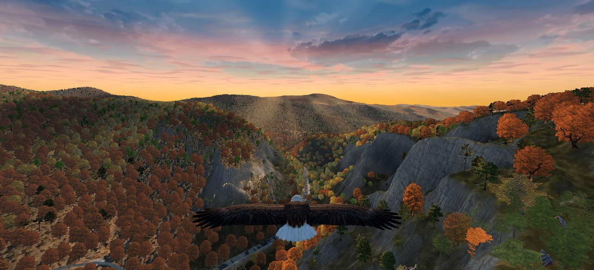
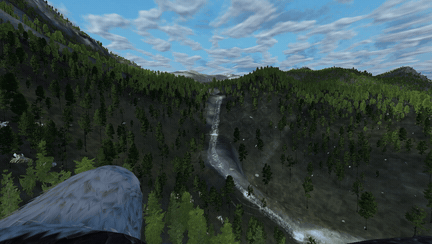
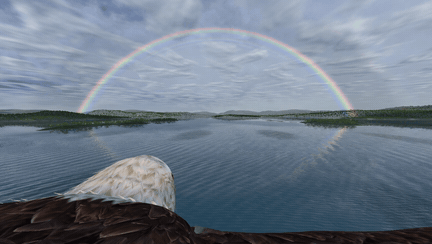
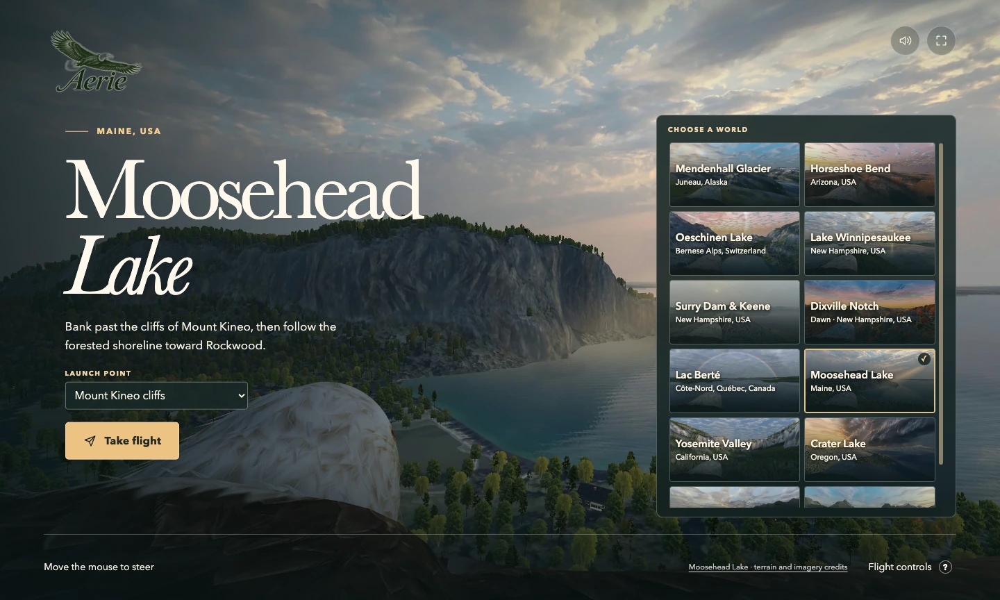

# Aerie

Fly a bald eagle through twelve real-world landscapes, looking out over its right shoulder. Follow a waterfall down to a glacial lake, catch rising air off a sunlit ridge, or settle on a branch and listen to the forest. Steer with your mouse or one finger.

**[Play Aerie in your browser](https://aerie-valley-flight.randyb308826.chatgpt.site/)** · [Download for offline play](https://github.com/TheComplianceAide/aerie-eagle-flight/releases/latest/download/Aerie.html)

[](https://aerie-valley-flight.randyb308826.chatgpt.site/#world=dixville&launch=dawn)

*Dixville Notch, New Hampshire. The chase camera opens up the view over the eagle’s wings.* [Watch the glide](docs/media/dixville-glide.gif)

## Choose a flight

| Nugget Falls · Alaska | Lac Berté · Québec |
| --- | --- |
| [](https://aerie-valley-flight.randyb308826.chatgpt.site/#world=alaska&launch=spray) | [](https://aerie-valley-flight.randyb308826.chatgpt.site/#world=lac-berte&launch=rainbow) |
| Fly close enough to see the wind carry spray off the ledges. [Fly the falls](https://aerie-valley-flight.randyb308826.chatgpt.site/#world=alaska&launch=spray) | Bank over the narrows as a sun shower breaks over the lake. [Fly the rainbow](https://aerie-valley-flight.randyb308826.chatgpt.site/#world=lac-berte&launch=rainbow) |

[](https://aerie-valley-flight.randyb308826.chatgpt.site/#world=moosehead&launch=lake)

*Pick a world and a launch point. At Moosehead Lake, the Mount Kineo cliffs launch puts you above the water facing the headland.* [Open the flight menu](https://aerie-valley-flight.randyb308826.chatgpt.site/#world=moosehead&launch=lake)

## How the world works

- **Flight.** Each wing samples the wind independently, so a gust can lift one wingtip before the other. The eagle steadies its head through a bank, fans its tail to slow down and reaches feet-first for a perch.
- **Terrain.** Three.js renders the landscape in WebGL. At Dixville’s Table Rock, lidar measurements shape the ground and treetops. At Moosehead, lake-depth surveys shape the underwater terrain. Regional canopy and ground cover stream into view as you fly. [Scenery and sources](docs/regional-scenery.md)
- **Weather and water.** Moving clouds shade ridges and lakes. Gusts roughen patches of open water and blow fine spray sideways at Nugget Falls. Along a river, the current runs faster away from the banks.
- **Sound.** Turn your head on a perch to place a birdcall in stereo. Glide behind the rock spur at Nugget Falls and the high hiss fades before the low rumble. Ten recorded bald-eagle phrases accompany takeoffs, climbs, glides and landings. [Field recording credits](game/field-audio-credits.txt)

**Regional soundscapes.** 80 regional recordings cover all twelve worlds. The headphone mix places calls in three dimensions, delays distant sounds by their travel time and reflects echoes off cliffs. Air absorption follows the day’s temperature and humidity at each real location, and pressing **L** or tapping **Eagle Ears** filters the mix toward a raptor’s hearing. Fly close to geese, ducks, ravens or other animals and they call out at once, geese honking over one another as you pass a flock; moose and deer can be heard walking through leaf litter, and ibex, bighorn, otters and western chipmunks have voices of their own. [Recording credits](game/soundscape-credits.txt)

## Play locally

[Download the offline game](https://github.com/TheComplianceAide/aerie-eagle-flight/releases/latest/download/Aerie.html) and open it in Chrome. Choose a world and select **Take flight**.

## Run from source

Clone or download this repository. From its root, start a local server with Python 3.

```sh
python3 -m http.server 8000 --bind 127.0.0.1 --directory game
```

Open [Aerie on your computer](http://127.0.0.1:8000/), choose a world and a departure point, and select **Take flight**. A WebGL-capable browser with graphics acceleration enabled is required. All game assets are included, and you can play offline.

For a portable single-file version, run the following command and then open the resulting `Aerie.html` in Chrome.

```sh
python3 tools/build_offline.py
```

## Lac Berté

Cloud shadows cross the spruce ridges, the cabin, and the lake while a sun shower catches the evening light. Choose **Rainbow over the narrows** for a view across the water or **Cabin flyby** to approach the white camp porch. The cabin is reconstructed from photographs. Its placement near the outfitter’s South Camp is approximate. [Outfitter’s lake guide and camp map](https://labrador-airsafari.com/en/lake)

## Finding wildlife

Every range has a named wildlife departure. In flight, press **V** or tap **Game Vision** to identify nearby animals. The game remembers your choice. Wildlife departures open with the overlay on until you choose a preference. The nearest species appear with their distance and bearing. An on-screen marker follows a visible animal. A close animal ahead of the eagle can trigger one of its recorded calls. Use the speaker button to control the sound.

The [regional wildlife credits](game/wildlife-credits.txt) document species and licensed recordings. New regions can register their local species, encounter and habitat through [the wildlife catalog](game/game-ranges.js). The [atmospheric optics credits](game/atmospheric-optics-credits.txt) describe the light conditions modeled in the ranges.

## Flight controls

**Mouse:** move toward the part of the screen where you want to fly. Left and right bank, up climbs, and down dives. Move the pointer back to the center ring to settle into a straight glide.

**Touch:** put one finger on the eagle or the scenery and slide in the direction you want to fly. Lift your finger to glide. On either device, steer farther upward to beat your wings. Tap or click a branch or ledge, then **Land**. Drag to look around while perched and select **Push off** to fly again.

The following keyboard shortcuts are also available.

| Action | Control |
| --- | --- |
| Pitch up or dive | W / S or Up / Down |
| Bank left or right | A / D or Left / Right |
| Flap | Hold Space |
| Spread wings and tail to slow down | Hold B or the on-screen Brake button |
| Change between shoulder and chase views | C |
| Explore landmarks | G |
| Identify nearby wildlife with Game Vision | V |
| Hide or show instruments | H |
| Pause | Esc |

Hold Up or W at low airspeed to start a powered climb. A dive tucks the wings. Pulling up reopens them and costs altitude while the flight path curves upward.

Choose **Break off** while approaching a perch to fly through an open escape route. If the feet are already reaching or terrain blocks the escape, the eagle grips the perch, turns and takes off again. **Stay on perch** cancels that takeoff while the eagle is still landing or turning.

Powered strokes vary with airspeed. Their low-speed cadence draws on a field study of six wild bald eagles, which averaged 2.53 wingbeats per second. The wrist flex and feet-first flare draw on high-speed recordings of a steppe eagle. [Bald eagle field measurements, p. 27](https://raptorresearchfoundation.org/wp-content/uploads/2023/02/conference_program_2017.pdf#page=29) · [Steppe eagle perching study](https://www.biology.ox.ac.uk/publication/209686/pubmed)

Each wing samples the wind over its own lifting surface. A gust can lift one side first, tilt the tail and roll the eagle before it trims back. A sharp loss of load can briefly drop both wings. The head holds a sightline through the bank, looks into turns, and can follow a visible bird or surfacing fish on a quiet glide. In a low-speed climb the tail opens and pitches against each strong wingbeat. On an exposed approach, the eagle can dip under a branch, flare up to it, and push off through its legs. Watch a perched eagle turn from chase view to see it lift one foot while the other holds the branch.

The feathers, eyes and bill move on their own. Each tail feather, primary and alula is a damped spring that bends with G, wingbeat load and gusts, so the wingtips flex in a pull-up and flutter in rough air while the head rides level. Clear third eyelids sweep across the eyes every few seconds, often with a head turn, and stay half drawn in a fast dive. The bill opens with each recorded call. On a perch the eagle scans its surroundings, bobs its head to judge distance, preens, shakes out its plumage and grows drowsy when left alone; its feathers and tail answer the wind at the perch. In rain it blinks more, shakes its head and shakes the water off once clear. The pace of perched head movements draws on studies of scanning hawks. Run `node tools/check_eagle_motion.cjs` to check the motion at 30 and 120 frames per second. [Hawk head movements on perches](https://pmc.ncbi.nlm.nih.gov/articles/PMC2943910/) · [Raptor head-turn timing](https://doi.org/10.1642/AUK-15-230.1)

The Chamonix bird-mounted footage was the visual reference for the shoulder view. Gust timing draws on flight recorders from a steppe eagle. The timing of short head turns and the shape of the final approach also draw on openly licensed 3D recordings of Harris’s hawks. The model adapts these observations to the player’s eagle, terrain and wind. [Bald eagle over Chamonix](https://www.youtube.com/watch?v=bceztrkJuVk) · [Steppe eagle gust study and recorder data](https://pmc.ncbi.nlm.nih.gov/articles/PMC4223896/) · [Open head-tracking data](https://doi.org/10.17617/3.LVTWX0) · [Open perching trajectories](https://doi.org/10.6084/m9.figshare.16529328)

Dark patches of rough water travel downwind. A circling bird on open wings marks a thermal. Bank into its circle to use the same rising air. These cues are visible from either camera.

Cloud banks drift across all twelve ranges. Their shadows follow the ridges, forest and water, and narrow mist banks drift with the local wind. In Alaska, choose [Nugget Falls spray pass](https://aerie-valley-flight.randyb308826.chatgpt.site/#world=alaska&launch=spray) to fly alongside the cascade. Fine spray blows off the ledges while larger drops fall back into the chute.

## Waterfall flights

Take the **Nugget Falls spray pass** in Alaska to see the water separate into streams, blow sideways in gusts and send ripples across Mendenhall Lake. At **Bowen Falls** in Milford Sound, fly down beside the curtain to see its spray drift into the fjord. Use **Explore** for Plaikni Falls, Falls of Song, Beaver Brook Falls, Cold Stream Falls and Rostadforsen. Each follows the local streambed down to its receiving water. [Regional waterfall surveys](game/regional-waterfalls-credits.txt)

## Try the world physics

| Departure | What to watch or listen for |
| --- | --- |
| Moosehead Lake · Wind across the reeds | A traveling dark patch on the water reaches the sedges and then the trees. Open water and sheltered woods respond differently. |
| Horseshoe Bend · Sunlit sandstone wall | Bank left alongside the wall. Look for cross-bedded sandstone, broken ledges and piles of fallen rock at the base. Warm light reaches the eagle’s white neck, then fades in the open canyon. |
| Lac Berté · Cabin flyby | Fly through the last curtain of rain toward the cabin. As the sun breaks through, look for the wet roof, puddles and runoff along the bank. |
| Moosehead Lake · Kineo Cove shoreward glide | Land on the shoreline limb and push off. The feet follow the branch as it dips under load, and the branch springs back after release. |
| Mendenhall Glacier · Around the Nugget Falls spur | With sound on, glide around the spur. The rumble carries through while the higher hiss returns when the falls come into view. Listen for delayed eagle calls beside rock walls. |
| Crater Lake · Caldera overlook | Look across Wizard Island. A break in the storm lights the western rim while a dark shelf of cloud and falling rain cross the lake. |

## Scenery and credits

Forests and ground cover continue between landmarks in every world. A twelve-cell lidar inset follows the ground and crowns at Table Rock. Other woodland fills use regional land cover and representative plant specimens. [Flight study, regional coverage and source photographs](docs/regional-scenery.md)

The playable worlds include Oeschinen Lake, Mendenhall Glacier, Horseshoe Bend, Yosemite Valley, Crater Lake, Lofoten, Milford Sound, Lake Winnipesaukee, Moosehead Lake, Surry Mountain Dam with Keene, Lac Berté in Québec, and Dixville Notch at dawn in New Hampshire.

Low passes reveal wind-bent photographed grasses, shrubs, and ferns. Position and head direction shape the stereo field of recorded birds near crowns, shores, and rocky ground. Exposed ridges and higher flight carry a stronger wind. Ten bald-eagle phrases from six field recordings accompany takeoffs, climbing, soaring, shoreline flight, and perching. The seven Yellowstone excerpts include the three recordings on the park’s bald-eagle page. Headphones make the direction of individual calls easiest to hear.

On a low shoreline pass, ripples turn toward the bank and leave a dark band on the exposed gravel. The water at Mendenhall Lake carries more glacial sediment than the clear shallows at Oeschinen. On the Merced and the Ashuelot, the current runs fastest away from the banks. The game models these waves, currents and shallow beds from the terrain and local setting.

In Moosehead, the low-sun cloud bank moves with the wind and appears in the lake reflection. At Surry Mountain Dam, look along the riprap crest toward the pale sun or across the still reservoir to see the forested ridges fade into daytime haze. The Route 26 departure in Dixville looks west into the rock teeth from the eastern bend.

Choose **Wildlife shallows** for a low departure past each region’s fish and shore birds. At Moosehead and Winnipesaukee, watch for mixed mallard and American black duck rafts, individual loons or pairs, and passing Canada goose flocks. Lac Berté’s shallows include brook trout.

See the [scenery and field-recording credits](game/credits.txt) for the source imagery, terrain, bird recordings, and their individual licenses. [Three.js](game/three-LICENSE.txt) and the bundled [pako decompressor](tools/pako/LICENSE) include their license notices.
